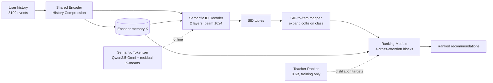

# Sona Technical Report 阅读笔记

> Yandex Music 用一个单模型替换 15+ 路召回、粗排、精排的生成式推荐系统

## 元信息

| 项 | 内容 |
|---|---|
| 标题 | Sona Technical Report: A Single-Model Generative Recommender for Yandex Music |
| 团队 | Sona Team, Yandex Music（33 人） |
| arXiv | [2608.11015v2](https://arxiv.org/abs/2608.11015) |
| 版本日期 | 2026-08-12 |
| 篇幅 | 30 页（含附录） |
| 阅读日期 | 2026-11-05 |
| 关键词 | generative recommendation, semantic ID, distillation, recommender systems, Yandex Music |

## 一句话总结

Sona 用一个共享用户编码器 + 语义 ID 自回归解码器 + 蒸馏排序头，替换掉 Yandex Music 生产环境里 15+ 路召回、粗排、精排的完整级联。线上 A/B（My Vibe 智能音箱，每个 split 15% 用户，7 天）：活跃用户 +4.53%、总收听时长 +6.30%、点赞 +11.42%。核心不是某个新模块，而是"统一表征 + 生成式召回 + item 级排序"的工程化落地，以及一套完整的在线训练/推理链路。

## 1. 背景：为什么要换掉级联

Yandex Music 原来的推荐栈是典型的多阶段级联：

- 15+ 路候选生成器（协同过滤、图、序列、内容等）
- 粗排（pre-ranking）
- 精排（ranking），吃几百个特征，包括 Argus 这类大 transformer 和 target-attention scorer

问题是每个阶段都要重复处理用户历史，特征管道复杂，serving 阶段多。Sona 想验证：**一个模型、一次用户编码，能不能同时做召回和排序？**

音乐域和短视频/电商有两个关键差异，直接影响了设计：

1. **消费是被动的**：播放会一直持续，用户的反馈更稀疏（播放、跳过、点赞、点踩）。
2. **重复听是常态，不是冗余**：回到熟悉的歌往往是用户想要的，所以"熟悉度 vs 新鲜感"的平衡是核心，不能把重复当降权信号。

## 2. 方法：五个部件

### 2.1 整体数据流



Serving 时只有 Encoder、Decoder、Ranking Module 三个部件；Teacher Ranker 和 Semantic Tokenizer 只用于训练。

### 2.2 语义 Tokenizer（离线）

目标：给每首歌一个短的离散 ID（Semantic ID, SID），让解码器可以像生成 token 一样生成物品。

流程：

1. **音频/文本表示**：冻结的 Qwen2.5-Omni 读入前 90 秒 mel 频谱 + 文本 prompt（标题、艺人、标签、年份等元数据），只做 prefill、不解码，取最后一层所有位置的 hidden states。
2. **Refinement transformer**：4 层、4 头、d=512，对 Qwen 的输出做精炼，再对 T 个位置做 mean pooling，得到 256 维 item embedding `z`。
3. **协同精调**：用两类协同对做 InfoNCE，同时加一个 alignment loss 让 `z` 靠近同一首歌的内容特征均值 `h_a`：
   - `L = L_InfoNCE + λ_align * L_align`，`λ_align = 0.1`
   - 目标对来源 1：target-wise co-served（推荐系统一次响应里共同曝光、跨艺人），3 周窗口，约 220–240M 对
   - 目标对来源 2：NPMI co-listening（共同收听、同艺人、高 NPMI），3 个月窗口，约 20M 对
   - 两条流不相交，拼起来打乱后训练
4. **残差 K-means**：3 级、每级 32,000 个 centroid，k-means++ 初始化，欧氏距离分配。第 1 级量化 `z`，第 2/3 级量化残差。每首歌得到 3 个码 `(c1, c2, c3)`。

这个 tokenizer 只在训练时用；serving 时 SID → item 是确定性映射，没有可学习参数。

### 2.3 用户历史表示

输入是按时间排序的曝光事件序列 `u = (e1, ..., eT)`，`T <= T_max`。不足的位置用共享的 learned embedding padding。

每个事件由三个 embedder 求和：

| Embedder | 输入信号 | 构造方式 |
|---|---|---|
| Item | track ID、artist ID、track duration | track ID hash 3 次、artist ID hash 2 次，写入共享 embedding 表；duration 分桶后 embedding |
| Context | 智能音箱 flag、organic-feed flag | 分别 embedding 后求和 |
| Feedback | like flag、play time | like flag embedding；play time / track duration = completion ratio，分桶后 embedding |

事件 token：`x_t = ItemEmb(e_t) + ContextEmb(e_t) + FeedbackEmb(e_t)`。最前面加一个 CLS token：`X = [x_CLS, x_1, ..., x_T]`。

论文说"没有手工特征"，更准确的说法是**没有手工交叉特征**；分桶、hash 次数、completion ratio 仍然是人工设计的。

### 2.4 共享 Encoder 与 History Compression

这是 Sona 在架构上最有意思的部分。完整历史 `N = 8192` 个事件，如果全部走深层 self-attention，serving 成本太高。History Compression 把历史拆成：

- 近端 recent block `R`：`n_r = 2048` 个最近事件
- 远端 long-term block `O`：`n_o = N - n_r` 个更早事件

四阶段编码：

1. **双向 cross-attention**：两个单层 cross-attention block，`O` 读 `R`，`R` 读 `O`，得到增强的 `Õ`、`R̃`。
2. **全历史 self-attention**：1 层，作用于 `[Õ; R̃]`，这是唯一混合整段历史的阶段。
3. **深栈只作用于近端**：7 层 self-attention 只跑在 recent block 上，得到 `H_R`。
4. **拼接读出**：`K = [X_O; H_R]`，所有 N 个位置对下游可见，但只有近端带深层编码。

Attention 成本约为 `Θ(L * n_r^2 * d + N^2 + 2 * n_r * n_o * d)`，相比全量深栈大约省一半。论文的离线消融（Table 7.7）显示 History Compression 在 8k 历史上 WPA 0.6033，略高于 full attention 的 0.6029；Teacher Recall@10 略低（0.6474 vs 0.6586）。也就是说，用它主要是买成本，质量上接近全注意力。

### 2.5 Decoder

浅层自回归 transformer，2 层，在 SID 词表上逐级生成：

```
p(s1, ..., sL | u) = Π p(s_l | s_<l, K)，L = 3
```

- 约束 beam search：用 tokenizer 的 trie 屏蔽非法前缀；serving 时 beam = 1024。
- 码本不是 collision-free：一个 SID tuple 可能对应少量曲目；每个完成的 tuple 展开成完整的 collision class，交给 Ranking Module 排序。
- Decoder 自己维护 KV cache；因为 beam decoding 的 KV 长度最多 3，作者写了专门的 attention kernel。

### 2.6 Ranking Module

生成式召回的弱点是 beam search 优化的是 token 序列似然，不是 item 相关性；SID 碰撞还会让不同曲目拿到同一个分数。Ranking Module 就是补这个洞：

- **候选表示**：item ID、各级 SID code（独立 embedding）、前缀 n-gram；每个特征用多个 hash 函数映射到与 encoder 共享的 embedding 表；拼接后投影成 `e_i`。
- **打分**：4 层 pre-norm cross-attention block，对共享的 `K` 做 cross-attention，得到 `ẽ_i`；再过一个 feed-forward scoring layer，输出 `n` 个 head 分数（最终配置是 2 个 teacher head 分数）。
- **合成**：固定权重的 combiner 把多 head 分数压成一个 scalar，对展开后的候选排序。

关键点：Ranking Module 和 Decoder 共享同一个 Encoder，用户历史只编码一次。

### 2.7 Teacher Ranker（只在训练期）

Teacher 是给 Ranking Module 提供排序目标的"大模型"：

| 项 | 配置 |
|---|---|
| 参数量 | 0.6B（embedding 表占大头） |
| Encoder | 10 层 causal transformer |
| Candidate scorer | 6 层 cross-attention |
| Hidden / heads | 1024 / 16（head dim 64） |
| 历史长度 | 预训练 2k，精调 8k |
| 数据跨度 | 一年量级的用户事件时间线 |
| 刷新 | 每 24 小时 |

训练分两阶段：

1. **NIP 预训练**：next-item prediction，InfoNCE + in-batch negatives + 混合均匀尾负样本池，带 logQ correction；预训练结束后丢弃预测头。
2. **多头排序精调**：主 head 做 pairwise，按参与度等级排序（like > play > skip > dislike），在相邻曝光对上用 logistic loss；其余 head 做 pointwise BCE。`L_teacher = L_pair + Σ L_BCE`。

工程上有个关键设计：Teacher 在**时间线级别**的数据上训练，一条样本是一个用户的一年事件时间线；causal encoder 在每个位置给出当时的用户状态，candidate scorer 通过自定义 cross-attention mask 只看 anchor 之前的历史。这样一次 encoder pass 可以监督整条时间线上的所有 target（用 Triton kernel 实现）。这就是"把一年历史压进 teacher 权重"的含义——**数据跨度是一年，单次上下文仍是 8k**。

## 3. 训练目标：NTP + 两路蒸馏

学生模型的联合损失：

```
L = L_NTP + L_rollout + L_impression
```

- **L_NTP**：对每个 request 的正反馈 item，映射成 SID tuple，做 teacher-forced 的 next-token prediction；encoder 每个 request 只跑一次，每个正样本作为独立序列解码。
- **L_rollout**：用当前 decoder 做 beam search（训练时 `B = 32`），把生成的 SID tuple 解析成曲目，成功解析的组成集合 `B`；Teacher 对 `B` 里的候选逐 head 打分；Ranking Module 回归 teacher 分数，per-head MAE。
- **L_impression**：对日志里真实曝光的 item 集合 `I`，同样让 Teacher 打分，Ranking Module 回归，per-head MAE。

两个蒸馏源的组合很重要：

- 只用 logged impressions：召回指标高，但 Teacher Recall 低——因为曝光分布和 serving 时候选分布不一致。
- 只用 rollouts：Teacher Recall 高，但 WPA 略低。
- 两者都用：Teacher Recall 接近 rollouts，WPA 更高。

最终权重是 `NTP : rollout : impression = 1 : 1 : 1`（Table B.3）。

## 4. 在线训练与推理：真正难的部分

Sona 能在生产上跑，靠的是一整套在线闭环，而不是单点模型：

```
用户事件 → 实时事件流 → session 聚合（15 分钟窗口）
        → 训练样本队列 → GPU trainer → 每 10 分钟同步一版模型
```

- **新鲜度**：从事件发生到新模型上线，中位 45 分钟，p99 60 分钟；Teacher 每 24 小时刷新。
- **Session 聚合**：按 user 分区，连续事件聚成 session；idle gap 几分钟 + 最小 15 分钟归因窗口；用内部 timer 驱动 session 超时。
- **流量过滤**：反作弊/机器人过滤、历史长度门槛（防止短历史主导梯度）、模型黑名单（防止探针/评估模型的流量回流进训练，形成 feedback loop）。
- **用户画像存储**：长历史放 KV，批量重建；实时 profile 只存最近 72 小时、最多 1000 个事件；两者按时间戳合并去重，重叠时以批量侧为准。
- **History join**：serving 时写一条 inference log（request ID + history cutoff）；session 聚合时按 session ID join，重建样本时 re-read profile，保证训练样本里的历史和模型当时看到的一致。
- **推理优化**：Triton Inference Server、CUDA graph、packed batch、固定 shape、bf16、torch.compile、beam decoding 专用 attention kernel、radix top-k；最终模型推理 MFU 41%。

## 5. 实验结果

### 5.1 离线消融

| 维度 | 关键结果 |
|---|---|
| 码本大小 | 3×32k：Recall@1000 0.8111；3×8.192k：0.8036 |
| Item 表示 | CLMR 音频 0.8111；CLMR + 协同投影 0.8139；Qwen2.5-Omni + 协同精调 0.8524 |
| 模型容量 | Small 20M core / 264M total；Medium 130M / 485M；2×Medium 260M / 659M；NTP loss 随容量下降，未见 plateau |
| 数据量 | 1 周 0.8333；2 周 0.8640；4 周 0.8849；8 周 0.8947（Recall@1000） |
| Teacher 预训练 | 有 NTP 预训练 WPA 0.6215；无预训练 0.6153 |
| Teacher 历史/深度 | 8k 历史 + 6 层 scorer 最好（WPA 0.6215） |
| 统一模型 | MAE 蒸馏 WPA 最高；rollouts + impressions 组合最优；训练 beam 32 性价比最高 |
| History Compression | 8k HC：WPA 0.6033 / Teacher R@10 0.6474；full attention：0.6029 / 0.6586 |

### 5.2 线上 A/B

所有数字是相对 production control 的增量；除 † 外均在 p < 0.01 下显著。

| 实验 | 配置 | Active Users | Total Listening Time | Likes | Repeat Commands | Deeply Engaged Users |
|---|---|---|---|---|---|---|
| Exp1 | pairwise only | +1.51% | +2.05% | -1.03%† | +7.43% | +2.61% |
| Exp1 | +α likes | +1.83% | +2.45% | +6.56% | +12.89% | +2.87% |
| Exp1 | +2α likes | +1.53% | +2.28% | +11.93% | +12.57% | +2.80% |
| Exp2 | Teacher 无 SID 特征 | +1.98% | +2.60% | +11.13% | +15.88% | +2.95% |
| Exp2 | Teacher 有 SID 特征 | +2.23% | +3.18% | +19.86% | +20.52% | +3.80% |
| Exp3 | 只换精排为 Teacher | +1.22% | +1.64% | +1.48%† | +4.68%† | +1.83% |
| Exp3 | Enc-Dec + Teacher | +2.72% | +3.63% | -0.54%† | +5.02% | +4.06% |
| Exp4 | 蒸馏单模型 | +1.41% | +1.62% | +7.12% | +15.25% | +2.78% |
| Exp4 | 蒸馏单模型 + Teacher 重排 | +2.81% | +4.32% | +11.81% | +14.93% | +5.11% |
| Exp5 | 完整 Sona | **+4.53%** | **+6.30%** | **+11.42%** | **+17.99%** | **+7.37%** |

实验规模：Exp1 每组 5% 用户；Exp2 每组 4%；Exp3 每组 3%；Exp4 每组 8%；Exp5 每个 split 15% 用户、7 天。

几个值得注意的结论：

- **多目标要线上调**：只优化 pairwise 时点赞 -1.03%；加 likes 权重后点赞 +6.56%；权重加到 2α 点赞 +11.93%，但 Active Users 从 +1.83% 回落到 +1.53%。最终选 α。
- **Teacher 加 SID 特征全面更好**：说明 SID 不只是召回 token，也是有效的排序特征。
- **单模型替换确实可行，但量级取决于 recipe**：Exp4 纯蒸馏单模型 +1.41% AU；Exp5 完整 Sona +4.53% AU。两者不是同一个实验，Exp5 还多了 8k 历史 + History Compression，不能把 +4.53% 全归因于架构替换。
- **蒸馏有 gap**：Exp4 里蒸馏单模型独自上线 +1.41% AU，加上 Teacher 重排能到 +2.81%，说明 student 没有完全吸收 teacher。

## 6. 批判性评估

### 6.1 真正有价值的点

1. **生产级验证**：不是离线刷点，而是在一个成熟、大流量的推荐面上，用单套参数替换 15+ 召回器 + 粗排 + 精排，并给出 5 组线上 A/B。这类证据在工业界很稀缺。
2. **Teacher 的数据跨度设计**：Teacher 吃一年时间线，Student 只吃几周；把长周期用户信号先压进 teacher 权重，再蒸给 student。这是一个很实用的数据杠杆，不要求 student 在 serving 时看一年历史。
3. **History Compression 的深浅不对称**：远端浅、近端深，8k 历史只付约一半 attention 成本，且离线质量接近全注意力。思路干净，容易复用。
4. **在线闭环的工程细节**：45/60 分钟的新鲜度、inference log 对齐 history cutoff、模型黑名单防 feedback loop、双存储 profile——这些比模型结构更难复制。
5. **消融诚实**：Exp1 显示优化点赞会伤 AU；Exp4 暴露蒸馏 gap；Limitations 明确承认 catalog coverage 下降、没有全量、没有验证其他 surface。

### 6.2 需要打问号的地方

1. **"Single model" 的边界**：严格说是"单套参数 + 一次用户编码"；serving 仍然是 generate → expand → rank 两段，不是单次前向。论文的措辞基本诚实，但容易被读成"一个 forward 出结果"。
2. **最终 +4.53% 是 recipe bundle**：8k 历史 + History Compression + 更大容量 + 在线训练 + 蒸馏，全都叠在一起。纯"单模型替换级联"在 Exp4 是 +1.41%，也显著，但量级差很多。作者自己也说 Exp4/Exp5 是分开的实验，不能隔离历史长度的贡献。
3. **Catalog coverage 下降**：作者承认 Sona 的 catalog coverage 低于原级联。生成式召回用 beam 1024 个 SID 覆盖全库，长尾/新歌/冷启是天然短板；"内容探索没有退化"只有弱证据，而且模型是在生产日志上训练的，存在选择偏差。
4. **A/B 的范围**：单 surface（My Vibe 智能音箱）、7 天、每个 split 最多 15% 用户；Active Users 这类指标容易受 novelty 影响；只报 p<0.01，没有置信区间。
5. **"No hand-engineered features" 有点营销**：duration/completion ratio 分桶、hash 次数、flag 选择都是手工设计。准确说法是"没有手工交叉特征"。
6. **成本被低估**：Teacher 0.6B、全库音频过 Qwen2.5-Omni tokenizer、在线训练每 10 分钟同步，这些都不是小开销。
7. **没有 RL post-training**：作者自己列为 future work；目前完全靠监督 + 蒸馏，长期收益（留存、探索）未必最优。

### 6.3 与相关工作的关系

- **Gryphon**（同团队，SIGIR 2026，arXiv 2606.08604）：Sona 架构的直接前作，提出 SID 生成 + item 级打分；单独替换召回时 TLT +0.25%（不显著），主要价值是简化系统。
- **Gryphon-v2**（同团队，2026-08，arXiv 2608.06213）：把排序也统一进来，用 Rollout Distillation 蒸馏 Teacher；线上 AU +1.41%，**和 Sona 的 Exp4 数字一致**，很可能就是 Sona Exp4 那套配置的论文版。Sona 可以看作在它之上加了 8k 历史 + History Compression 的完整技术报告。
- **Argus**（同团队，KDD 2026，arXiv 2507.15994）：1B 参数推荐 transformer 的 scaling recipe，Sona 之前该 surface 的最强基线（AU +1.93%）。
- **Gated Bidirectional Linear Attention**（同团队，SIGIR 2026，arXiv 2606.07317）：长历史 encoder 的线性注意力加速，和 History Compression 是同一类问题的不同解法。
- **HSTU / OneRec / GPR / EGA**：同期工业界"生成式推荐替代级联"的浪潮；Sona 的差异化在音乐域、teacher-student 长周期蒸馏和生产级 A/B。

## 7. 可迁移的 Takeaway

1. **统一表征优先于统一 forward**：先把"一次用户编码、多处复用"做掉，再谈端到端单模型。这是性价比最高的一步。
2. **Teacher 用更长数据跨度，Student 用更短窗口**：长期信号不一定要在 serving 时保留，可以压进 teacher 权重再蒸出来。
3. **长历史用不对称深度**：近端深、远端浅，比"全量深栈"便宜得多，质量损失可控。
4. **生成式召回必须配 item-level ranker**：beam likelihood 不等于 item relevance，SID 碰撞还会同分。
5. **在线闭环的关键是"样本和 serving 看到同一段历史"**：inference log + history cutoff 是个值得抄的设计。
6. **多目标权重只能线上调**：离线指标（Recall、WPA）不能替代 Active Users；点赞权重加到 2α 会伤 AU。

## 8. 关键术语

| 术语 | 含义 |
|---|---|
| SID (Semantic ID) | 用离散码本表示物品的短 token 序列，这里是 3 级 × 32k 码本 |
| NTP | Next-Token Prediction，对正反馈 item 的 SID 做自回归监督 |
| NIP | Next-Item Prediction，Teacher 的预训练任务 |
| Rollout Distillation | 用当前 decoder 的 beam 采样 + Teacher 打分，蒸馏 Ranking Module |
| logQ correction | 修正 in-batch negative 的采样偏差 |
| NPMI | Normalized Pointwise Mutual Information，用于挖共听对 |
| Collision class | 同一个 SID tuple 对应的所有曲目集合 |
| MFU | Model FLOPs Utilization，模型算力利用率 |
| FSDP | Fully Sharded Data Parallel，全分片数据并行 |

## 9. 原文重要图表

- Figure 2.1：Sona 整体架构与数据流
- Figure 3.1：语义 tokenizer 的音频/文本 → SID 流程
- Figure 3.2：History Compression 的四阶段结构
- Figure 4.1：NTP + Rollout/Impression 蒸馏的联合训练
- Figure 6.1：在线训练基础设施
- Table 7.6：统一模型的一因素消融（蒸馏损失、候选源、beam 大小）
- Table 7.7：Ranking Module 深度与 History Compression
- Table 7.8–7.12：五组线上 A/B
- Table B.1–B.7：tokenizer、teacher、ranking module、encoder-decoder、在线训练的完整超参

## 10. 延伸阅读

- Gryphon-v2: <https://arxiv.org/abs/2608.06213>
- Gryphon: <https://arxiv.org/abs/2606.08604>
- Argus (Scaling Recommender Transformers to One Billion Parameters): <https://arxiv.org/abs/2507.15994>
- Gated Bidirectional Linear Attention for Generative Retrieval: <https://arxiv.org/abs/2606.07317>
- Embedding Items at Scale: <https://arxiv.org/abs/2607.26365>
- Yambda-5B（Yandex Music 公开数据集）: <https://arxiv.org/abs/2505.22238>
- HSTU / Actions Speak Louder than Words: <https://arxiv.org/abs/2402.17152>
- Semantic IDs (Rajput et al.): <https://arxiv.org/abs/2305.05065>
- OneRec: <https://arxiv.org/abs/2506.13695>
