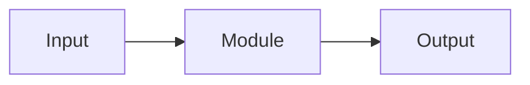

# {{论文标题}} 阅读笔记

> {{一句话副标题}}

## 元信息

| 项 | 内容 |
|---|---|
| 标题 | |
| 团队/作者 | |
| arXiv / DOI | |
| 版本日期 | |
| 篇幅 | |
| 阅读日期 | |
| 关键词 | |

## 一句话总结

{{三句话以内：做了什么、怎么做的、结果如何}}

## 1. 问题与背景

{{这个工作要解决什么问题？之前的方法为什么不够？}}

## 2. 方法

### 2.1 整体数据流

### 2.2 关键模块

{{逐个模块写清楚输入、输出、关键设计}}

## 3. 训练目标

{{损失函数、监督信号、训练阶段}}

## 4. 实验

### 4.1 离线

| 维度 | 结果 |
|---|---|
| | |

### 4.2 线上 / 端到端

| 指标 | 结果 |
|---|---|
| | |

## 5. 批判性评估

### 5.1 真正有价值的点

1. 
2. 
3. 

### 5.2 需要打问号的地方

1. 
2. 
3. 

### 5.3 与相关工作的关系

- 

## 6. 可迁移的 Takeaway

1. 
2. 
3. 

## 7. 关键术语

| 术语 | 含义 |
|---|---|
| | |

## 8. 原文重要图表

- Figure:
- Table:

## 9. 延伸阅读

- 
